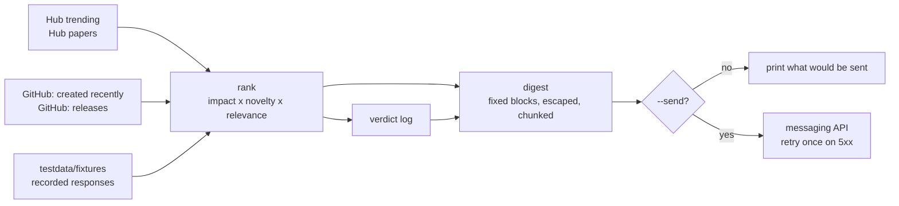

# tech-radar

[](https://github.com/lasttoss/tech-radar/actions/workflows/ci.yml)

A daily technology radar: signals from Hugging Face and GitHub, scored by a rubric
that is written down and tested, delivered as a message, and closed out as
decisions. Go, no dependencies outside the standard library, and a demo that runs
offline with no token.

```
make demo           # the pipeline on recorded signals: prints what it would send
make demo-closed    # the same pipeline over items that already have a verdict
make test           # go test -race ./...
```

## What this demonstrates

Reading a feed is easy. This repository is about the four steps around it, and the
last one is the reason it exists.

| step | what it does | where |
|---|---|---|
| **ingest** | four live sources: Hub trending models, Hub daily papers, repositories created recently, releases of a repository being watched | `internal/source/` |
| **rank** | a rubric of impact, novelty and relevance - as code, with tests, printing which words matched so a ranking can be argued with | `internal/rank/` |
| **deliver** | a fixed message shape, HTML escaped, chunked under the transport limit that once split a report mid-item, validated before anything is sent | `internal/digest/`, `internal/notify/` |
| **close** | every item that looked relevant ends as `adopt`, `watch` or `reject`, with the measurement attached; the digest carries the verdict into the message | `internal/decision/` |

The rules that make the last step more than a note-taking habit:

1. A verdict without a measurement does not load. The code refuses it.
2. An `adopt` must name the commit that took it, or it does not load either.
3. A `reject` is a result and gets written down like any other - the reject in
   `decisions/` is why a whole class of model never reached a product.
4. Verdicts carry dates, because a verdict about a model from six months ago is
   history, not advice.

## The verdicts

| item | verdict | evidence |
|---|---|---|
| `Qwen/Qwen3-VL-8B-Instruct` | **reject** | state reading came back empty: 3165 characters of thinking and no answer, and that tag cannot be asked to skip it |
| `Qwen/Qwen2.5-VL-7B-Instruct` | **watch** | 6 of 7 frame fields correct in 9.1s / 62 tokens locally; wrong on region colours |
| `Anionex/agent-vision-toolkit` | **watch** | the harness was proven working first (200, 1.18 MB), which is what made a white page a model finding rather than a pipeline bug |

The experiment logs are in `experiments/`. There is no `adopt` row in this public
copy on purpose: the real log has several, each naming a commit in a repository
that is not public, and `internal/decision` will not accept one without a commit -
so they are left out rather than invented. `decisions/applied.md` says the same
thing in the place you would look for it.

## How it works



Every source normalises to one item shape, so ranking and rendering never learn
where something came from, and a new source is one file plus one test.

## Quickstart

```bash
git clone <this repo> && cd tech-radar
make demo            # no Go install needed: everything runs in a container
make test
```

To deliver for real, copy `.env.example` to `.env`, fill in a bot token and a chat
id, then `make send`. Without it every command is a dry run, and `docker compose
run --rm radar` picks the dry run automatically when no token is present.

To refresh the recordings from the live APIs:

```bash
make record          # rewrites testdata/fixtures/items.json
UPDATE_GOLDEN=1 make test
```

## Recorded, not invented

`testdata/fixtures/README.md` lists every file, the exact endpoint it came from, and
the date it was recorded. The suite replays those responses, so `make test` needs
no network and no token, and CI is not at the mercy of a rate limit.

The digest this repository ships as a golden file is generated from those
recordings: `testdata/golden/payload.txt` is what the pipeline produces for a fixed
instant over fixed input, so any change in ranking, escaping or verdict attachment
shows up as a diff.

## What the recordings taught us

- **The search API is the fragile source.** Unauthenticated it is rate limited per
  IP, and it failed on the first attempt here. The error surfaces rather than
  turning into an empty digest, because a pipeline that reports a quiet day while
  it is actually blocked is worse than one that fails loudly.
- **Newest and most starred is not the same as interesting.** The first recorded
  search returned a star-farmed repository at the top. That is what the relevance
  term is for, and why the digest prints the matched words instead of only a rank.
- **A rubric needs a boundary rule.** Substring matching had `go` matching `google`.
  Relevance matches whole words now, and the test that proves it is the one that
  failed when it did not.

## Layout

```
cmd/radar            one binary: --record, --items, --limit, --send, --now
internal/source      Hub and GitHub adapters, each with fixture-driven tests
internal/rank        the rubric
internal/digest      message shape, escaping, chunking, validation
internal/notify      delivery, with a dry-run path
internal/decision    the verdict log and its rules
testdata/fixtures    recorded API responses
testdata/golden      the digest for a fixed instant
digests/             the archive this instance actually produced
experiments/         the measurement behind each verdict
docs/design-notes.md trade-offs, and the gaps that are still open
```

## Known gaps

No deduplication across sources, no scheduling in the repository (the daily run is
an external timer), no delivery state, and the search API stays the weak link
without a token. `docs/design-notes.md` has the details and the reasons.

On delivery specifically: the send path is tested against a local HTTP server
(retry on 5xx, no retry on 4xx, typed payload, dry run by default), and this
repository has never sent a message - doing that needs a token, and the first real
send should be yours.

## License

MIT. Nothing here comes from a work project: see `PROVENANCE.md`.
